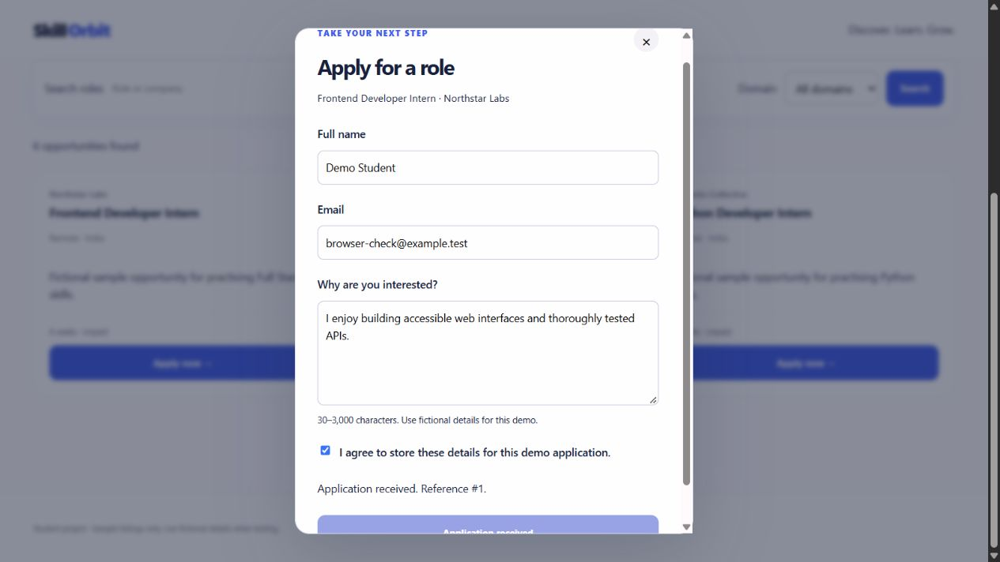
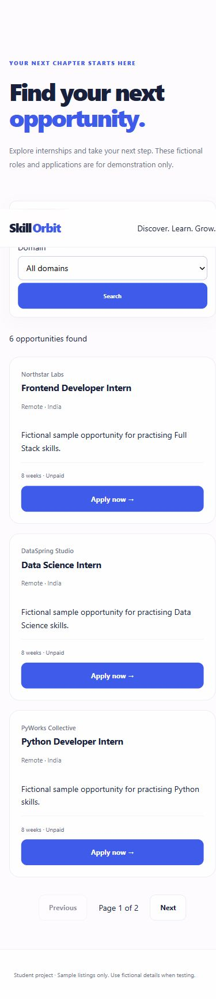

# Secure Application Integration

Task 04 by Syed Anwar Shazeb (Devop785): a responsive internship board connected to an Express/SQLite API, with a validated application form and security protections. This is an integrated, independently runnable project; Tasks 02 and 03 do not need to run alongside it.

## Run
Requires Node.js 22.13+ (tested: 22.20.0).

```sh
npm ci
npm run seed
npm start
```

Open **http://127.0.0.1:3002**. Stop with Ctrl+C. SQLite's experimental warning on Node 22 is expected. `npm test` runs isolated automated tests. `npm audit` checks installed dependencies.

Configuration: `PORT` defaults to 3002, `DB_PATH` to data/internships.sqlite, and `PUBLIC_ORIGIN` to http://127.0.0.1:3002 (or the configured port). If you use localhost rather than 127.0.0.1, set PUBLIC_ORIGIN to that exact origin before starting. The server binds to loopback. No credentials or external services are required.

## Features
- API-driven listings, search, domain filtering and pagination.
- Visible loading, no-results, failure and retry states; obsolete search responses are ignored.
- Accessible native application dialog with labelled fields, keyboard controls and live status messages.
- Client validation and independent server validation.
- Form entries remain available on failure; a 10-second request timeout and explicit retry support network recovery.
- SQLite application persistence, foreign keys and atomic duplicate prevention by internship/email.
- Rate limits, secure HTTP headers, same-origin submission restrictions and parameterized SQL.
- No public applicant-list endpoint; responses do not return applicant details.

## API
- GET /api/internships?page=1&limit=3&q=python&domain=Python
- GET /api/internships/:id
- GET /health
- POST /api/applications

Listing results use `{data: [...], meta: {page, limit, total, totalPages}}`. Details use `{data: {...}}`. Search supports company, role and description. Limits are 1–100; page is 1–1,000,000. Unknown query parameters are rejected. Public internship mutations are disabled in this integration.

Applications require Content-Type: application/json and X-Application-Request: 1:

```json
{"internshipId":1,"fullName":"Demo Student","email":"demo@example.test","coverLetter":"I enjoy building accessible interfaces and tested web applications.","consent":true}
```

Successful response (201): `{"data":{"id":1,"status":"received"}}`.

Name: 2–100 trimmed characters, no control characters. Email: valid format up to 254 characters, normalized to lowercase. Cover letter: 30–3,000 trimmed characters. Consent must be boolean true. Internship ID must be a positive safe integer referencing an existing role. Unknown fields are rejected. Request body limit: 16kb.

Errors use `{error:{code,message,details:[]}}`. Status codes: 400 invalid data/JSON; 403 rejected origin/header; 404 unavailable role/route; 405 disabled mutation; 409 already submitted; 413 oversized body; 415 wrong content type; 429 rate limited; 500 unexpected failure. A 409 following a failed network response means an application already exists for the supplied email and role. Do not automatically repeat writes without user action.

## Data and structure
- public/: responsive frontend, stylesheet and browser interactions; no framework.
- src/integration.js: public routes and security middleware.
- src/app.js: reused internship API, mounted behind read-only restrictions.
- src/database.js, db/schema.sql: persistent SQLite storage and constraints.
- db/seed.json and db/seed.sql: six fictional records, idempotent seed import.
- test/: HTTP integration/security and simulated-DOM frontend tests.
- docs/TEST-REPORT.md and docs/SECURITY-CHECKLIST.md: submission evidence.

Run npm run seed before first use. It preserves existing IDs and applications. Runtime databases are excluded from Git, so no submitted details are uploaded. The schema is intended for a new Task 04 database, not automatic migration of a Task 03 database.

## Submission evidence
[Read the test report](docs/TEST-REPORT.md) · [Security checklist](docs/SECURITY-CHECKLIST.md)




The visible screenshot requirements are implemented. The linked course product brief, official test records and starter checklist were not provided; the included records are original fictional examples, not claimed to be the official dataset.
